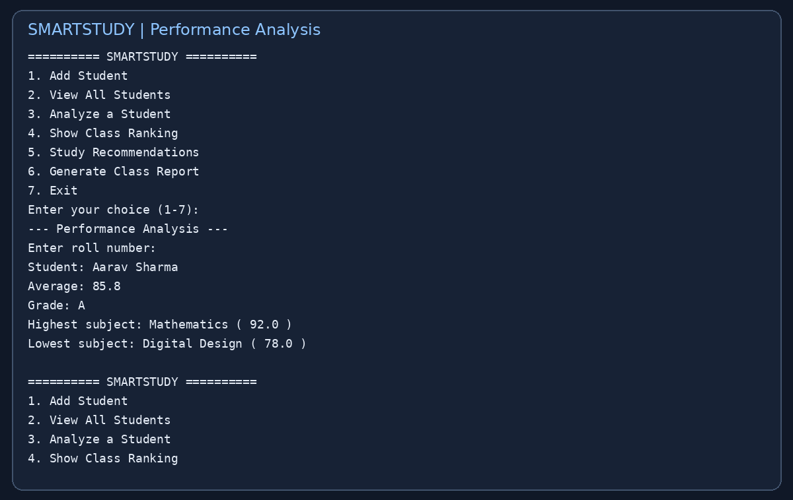
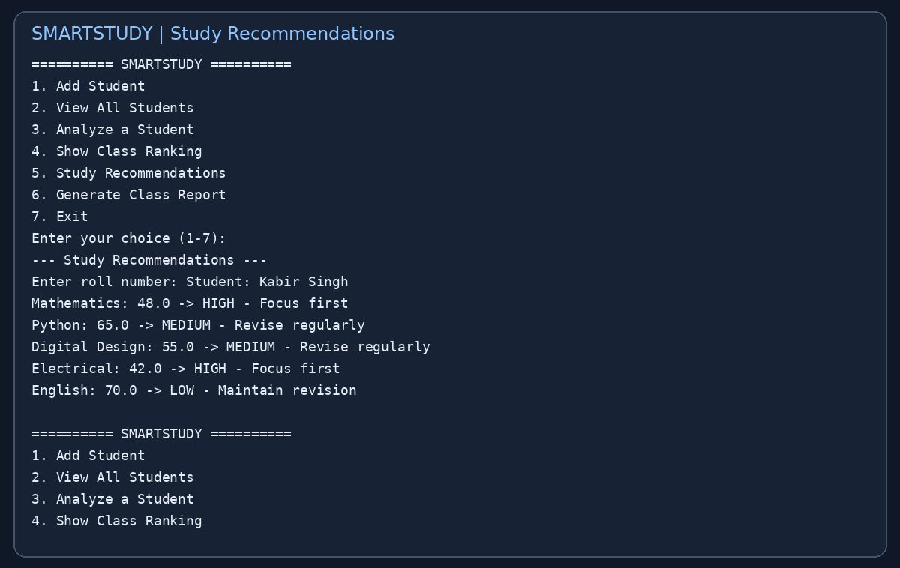
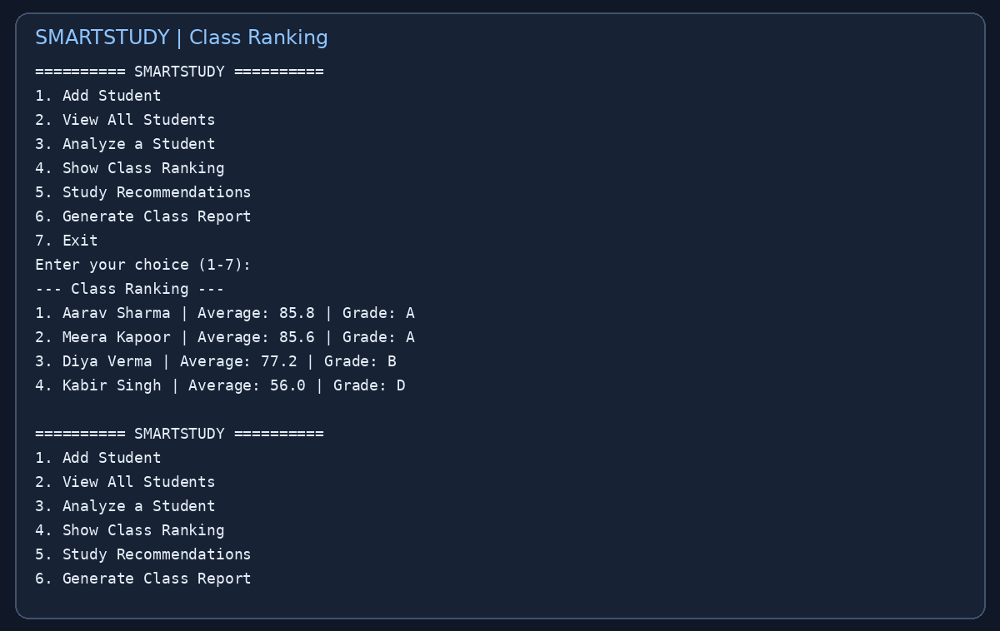
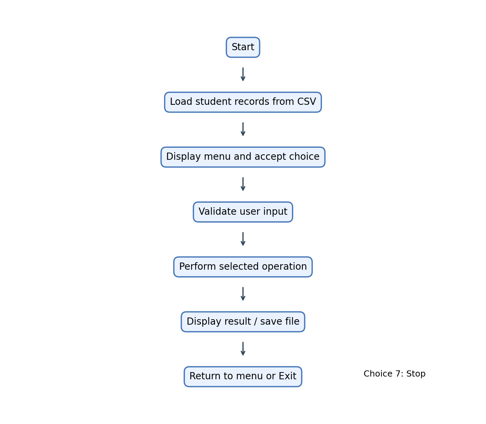

# 📚 SmartStudy – Student Performance & Study Planner

<p align="center">
  **A Python-Based Student Performance Analysis and Study Planning System**
</p>

<p align="center">
  Computational Thinking and Programming | 2026CSAE100  
  Bennett University | Academic Year 2026–27
</p>

---

## 📌 About the Project

SmartStudy is a beginner-friendly, menu-driven Python application developed to help students analyse their academic performance and identify subjects that require more attention.

The program stores student information and subject marks using CSV file handling. It calculates averages, assigns grades, identifies the highest- and lowest-scoring subjects, generates class rankings and provides rule-based study recommendations.

The project demonstrates how fundamental Python programming concepts can be used to solve a practical academic problem.

## 🎯 Project Objectives

- Store student names, roll numbers and subject-wise marks.
- Calculate student averages and performance grades.
- Identify each student's strongest and weakest subjects.
- Generate class rankings based on average marks.
- Provide study recommendations using conditional logic.
- Generate a text-based class performance report.

## ✨ Features

### 1. Student Record Management
- Add new student records.
- Store names, roll numbers and marks.
- View all saved student records.
- Prevent duplicate roll numbers.
- Save records in a CSV file.

### 2. Performance Analysis
- Calculate the overall average across five subjects.
- Assign grades based on average marks.
- Identify the highest-scoring subject.
- Identify the lowest-scoring subject.

### 3. Class Ranking
- Sort students in descending order of their average marks.
- Display student positions, averages and grades.

### 4. Study Recommendations
The program assigns priorities according to subject-wise marks:

| Marks | Priority | Recommendation |
|---|---|---|
| Below 50 | HIGH | Focus first |
| 50 to below 70 | MEDIUM | Revise regularly |
| 70 or above | LOW | Maintain revision |

### 5. Report Generation
- Generate a class performance report.
- Include student rankings, averages and grades.
- Save the generated report as `class_report.txt`.

## 🧮 Grading System

| Average Marks | Grade |
|---|---|
| 90 and above | A+ |
| 80–89.99 | A |
| 70–79.99 | B |
| 60–69.99 | C |
| 50–59.99 | D |
| Below 50 | Needs Improvement |

## 🖥️ Program Menu

The application provides seven menu options:

1. Add Student
2. View All Students
3. Analyze a Student
4. Show Class Ranking
5. Study Recommendations
6. Generate Class Report
7. Exit

## 🛠️ Technologies Used

- **Programming Language:** Python
- **Data Storage:** CSV
- **Report Generation:** TXT file handling
- **Python Modules:** `csv` and `os` (built-in modules)

### Python Concepts Implemented

- Variables and data types
- Conditional statements (`if`, `elif`, `else`)
- Loops (`for` and `while`)
- Lists and dictionaries
- Functions and modular programming
- File handling
- Exception handling (`try` and `except`)
- Sorting and basic mathematical calculations

## ⚙️ Installation and Execution

### Requirements
- Python 3 installed on your computer.
- Visual Studio Code or any Python-compatible editor.

No external Python libraries are required.

### Steps to Run

**1. Clone the repository**

```bash
git clone https://github.com/Cosmic-086/SmartStudy-Student-Performance-and-Study-Planner.git
```

**2. Open the project folder**

```bash
cd SmartStudy-Student-Performance-and-Study-Planner
```

**3. Run the Python program**

```bash
python smartstudy.py
```

**4. Select an option**

Choose any menu option from 1 to 7 and follow the instructions displayed in the terminal.

**Important:** Keep `smartstudy.py` and `students.csv` in the same directory while running the application.

## 📸 Project Screenshots

### 1. Individual Performance Analysis

Displays a student's average, grade, highest-scoring subject and lowest-scoring subject.



### 2. Study Recommendations

Displays HIGH, MEDIUM and LOW study priorities according to subject marks.



### 3. Class Ranking

Displays students ranked according to their overall average marks.



### 4. Program Flowchart

Illustrates the logical flow of the SmartStudy application.



## 📂 Project Structure

```text
SmartStudy-Student-Performance-and-Study-Planner/
│
├── smartstudy.py
├── students.csv
├── class_report.txt
├── DATA_NOTE.txt
├── README.txt
├── README.md
│
├── SmartStudy_Project_Report.docx
├── SmartStudy_Presentation.pptx
│
└── screenshots/
    ├── 01_performance_analysis.png
    ├── 02_study_recommendations.png
    ├── 03_class_ranking.png
    └── flowchart.png
```

## 🧪 Testing

The program was tested with normal, boundary, invalid-range, invalid-type and invalid-menu inputs.

| Test Case | Input | Expected Behaviour |
|---|---|---|
| Valid marks | 0–100 | Accept marks |
| Boundary value | 100 | Accept marks |
| Invalid range | -5 or 105 | Display validation message |
| Invalid data type | abc | Ask for a valid number |
| Invalid menu choice | 9 | Display invalid choice message |

All five test cases passed during project testing.

## 👥 Team Members & Contributions

This project was collaboratively developed by four team members:

| Team Member | Contribution |
|---|---|
| Advika Goyal | Python program structure, menu interface and integration |
| Hardik Vats | Student record management, CSV/TXT storage and file handling |
| Hrishita Negi | Average and grade calculations, subject analysis and class ranking |
| Vinyasa Choudhary | Study recommendations, testing, output validation and documentation |

All team members are expected to understand the complete program and its working.

## 🚀 Future Improvements

Possible future enhancements include:

- A graphical user interface (GUI).
- Graphical charts for subject-wise performance.
- Options to edit or delete existing student records.
- Attendance tracking.
- More personalised study plans.

## ⚠️ Important Notes

- The sample student names and marks are fictional demonstration data.
- Marks must be between 0 and 100.
- Student records are stored locally in `students.csv`.
- The project uses basic Python programming and does not use machine learning or advanced AI.

## 📚 References

- [Python Official Documentation](https://docs.python.org/3/)
- [Python CSV Module](https://docs.python.org/3/library/csv.html)
- Bennett University – Computational Thinking and Programming (2026CSAE100).

---

<p align="center">
  **Developed with Python as part of the Computational Thinking and Programming course at Bennett University.**
</p>

<p align="center">
  SmartStudy – Store. Analyse. Rank. Recommend.
</p>
